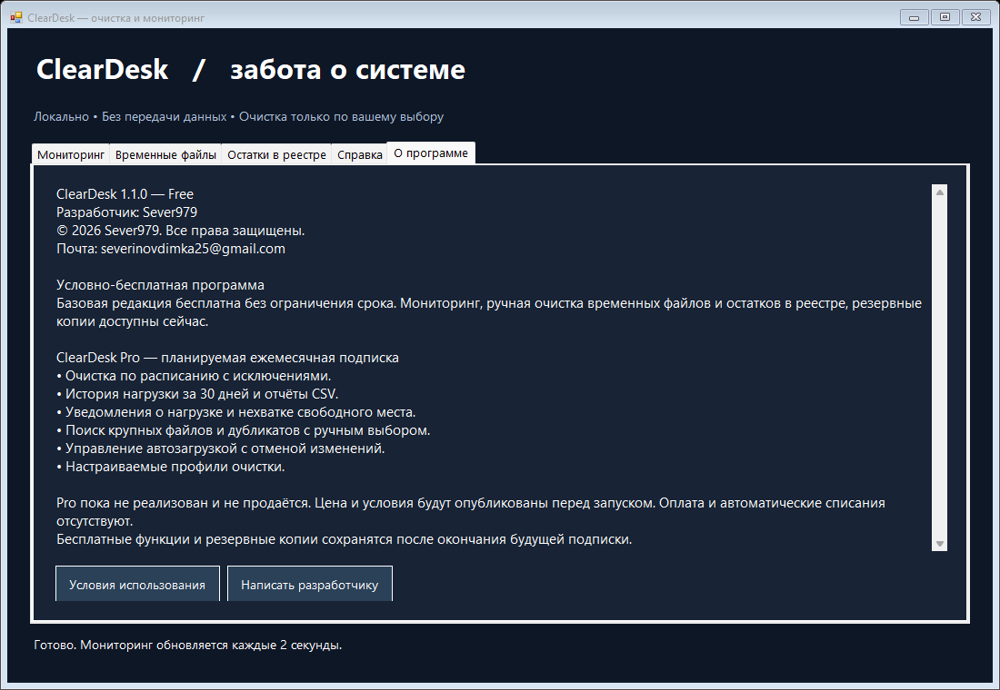
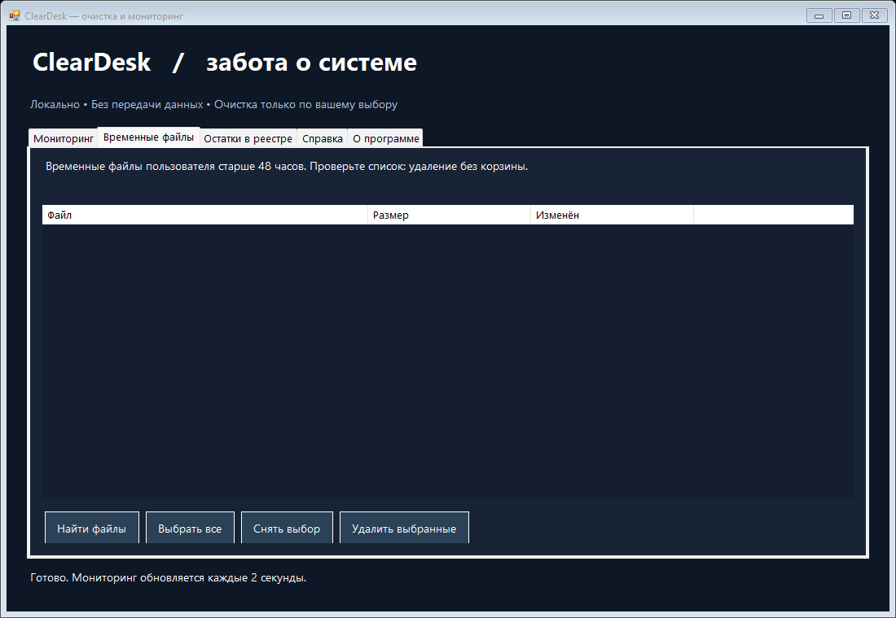

# ClearDesk

**Локальная очистка и мониторинг Windows · Free 1.1.0 · разработчик Sever979**

ClearDesk — небольшая программа на C# / Windows Forms с русским интерфейсом. Показывает нагрузку системы, помогает вручную очистить временные файлы и проверить оставшиеся записи удалённых приложений. Данные обрабатываются на компьютере пользователя.



## Возможности версии 1.1

| Раздел | Что работает сейчас |
| --- | --- |
| Мониторинг | Загрузка CPU с графиком, использование RAM, свободное место на дисках, суммарная скорость сети |
| Процессы | До 25 процессов с наибольшим рабочим набором памяти |
| Временные файлы | Поиск в пользовательском Temp, просмотр, выбор и ручное удаление файлов старше 48 часов |
| Реестр | Поиск вероятных остатков приложений в Uninstall HKCU/HKLM, представления 32 и 64 бита |
| Резервные копии | Экспорт каждой выбранной записи в `.reg` перед удалением |
| Трей | Мониторинг при свёрнутом окне; выход при закрытии окна |
| Установка | Установка для текущего пользователя, ярлыки, удаление через настройки Windows |

Мониторинг обновляется раз в две секунды. В программе нет телеметрии, автоматической очистки, фоновой службы или автоматического запуска при входе в Windows.

## Установка и запуск

1. Откройте [выпуск v1.1.0](https://github.com/Sever979/ClearDesk./releases/tag/v1.1.0).
2. Скачайте `ClearDesk-Setup.exe`.
3. Откройте установщик, прочитайте условия использования и нажмите «Установить».
4. Запустите ClearDesk через ярлык на рабочем столе или в меню «Пуск».

Папка установки: `%LOCALAPPDATA%\Programs\ClearDesk`. Права администратора для обычной установки не требуются. `ClearDesk.exe` из архива portable можно запускать без установки. Для обновления сначала закройте предыдущую версию.

**Требования:** Windows с .NET Framework 4.x и графическим рабочим столом; для сборки — Windows PowerShell и компилятор .NET Framework. Сборка проверена локально; отдельная матрица совместимости разных выпусков Windows пока не выполнена. EXE не подписаны цифровым сертификатом.

Удаление: **Параметры Windows → Приложения → ClearDesk → Удалить**. Резервные копии реестра сохраняются.

## Очистка временных файлов



На вкладке «Временные файлы» нажмите «Найти файлы», проверьте список, отметьте нужные позиции и нажмите «Удалить выбранные». По умолчанию ничего не выбрано. Удаление выполняется **без корзины** после подтверждения.

Сканируется только пользовательская временная папка. Файлы моложе 48 часов, изменённые после сканирования файлы, недоступные файлы и пути через reparse points пропускаются. Каталоги не удаляются. Браузерные профили, документы и загрузки не входят в область очистки.

## Работа с реестром и восстановление

ClearDesk проверяет только разделы списка установленных приложений `Software\Microsoft\Windows\CurrentVersion\Uninstall` в HKCU/HKLM. Кандидат должен иметь одновременно отсутствующую папку установки и отсутствующий EXE деинсталлятора внутри этой папки на системном диске. MSI, системные компоненты, сетевые пути и неоднозначные команды пропускаются.

Отсутствие папки может означать перенос программы. Каждый кандидат нужно проверить вручную. Это не универсальный поиск ошибок реестра и не обещание ускорения компьютера.

Перед удалением выбранной записи создаётся файл в `%LOCALAPPDATA%\ClearDeskBackups`. Если экспорт не удался, удаление не выполняется. Для изменения HKLM используйте кнопку «От администратора».

Восстановление из терминала:

```powershell
reg import "C:\путь\к\копии-64.reg" /reg:64
reg import "C:\путь\к\копии-32.reg" /reg:32
```

Используйте одну команду согласно суффиксу `-64.reg` или `-32.reg`. Для HKLM нужен терминал от администратора. Файловая очистка не имеет аналогичного механизма восстановления.

## Free и будущая подписка Pro

ClearDesk — **условно-бесплатная программа (freemium)**. Все перечисленные выше функции доступны бесплатно без ограничения срока. Резервные копии реестра остаются бесплатными.

Планируемые функции ежемесячной Pro-подписки:

- Очистка по расписанию с исключениями.
- История нагрузки за 30 дней и экспорт CSV.
- Настраиваемые уведомления о нагрузке, памяти и свободном месте.
- Поиск крупных файлов и дубликатов с ручным выбором.
- Управление автозагрузкой с отменой изменений.
- Профили очистки.

**Pro ещё не реализован и не продаётся.** В версии 1.1 нет оплаты, активации, проверки подписки и автоматических списаний. Цена, сроки и окончательные условия не определены. Подробнее — [план развития](ROADMAP.md).

## Сборка из исходников

Из корня репозитория:

```powershell
powershell -NoProfile -ExecutionPolicy Bypass -File .\source\build.ps1
```

Скрипт создаёт `ClearDesk.exe` и `ClearDesk-Setup.exe` в корне. Используется системный `csc.exe` из `%WINDIR%\Microsoft.NET\Framework64\v4.0.30319`; NuGet-пакеты не требуются. Полный текст лицензии встраивается в оба EXE. GitHub Actions выполняет сборку и сохраняет артефакты. При push в main отдельный этап публикует выпуск v1.1.0, если его ещё нет; существующий выпуск не перезаписывается. Подпись кода не выполняется.

## Проверки

В Windows с графической сессией:

```powershell
$test = Start-Process .\ClearDesk.exe -ArgumentList '--test' -Wait -PassThru
$test.ExitCode
Get-Content .\test-result.txt
```

Тест проверяет возраст файлов, защиту изменённых файлов, границы папки, условия определения кандидатов реестра и отрисовку вкладок. Он использует собственные временные файлы и сохраняет `preview*.png` рядом с EXE.

Для проверки экспорта, удаления и восстановления **собственной синтетической записи HKCU**:

```powershell
$test = Start-Process .\ClearDesk.exe -ArgumentList '--registry-test' -Wait -PassThru
$test.ExitCode
Get-Content .\registry-test-result.txt
```

Этот тест кратковременно изменяет только специально созданную запись `ClearDesk-Test-*`, проверяет импорт 64-битной копии, затем удаляет тестовую запись и копию. Настоящие записи приложений он не очищает. Локально оба набора проверок прошли; это не исчерпывающий аудит безопасности.

## Структура

```text
source/                  Приложение, установщик, метаданные и скрипт сборки
docs/images/             Скриншоты интерфейса
.github/workflows/       Автоматическая сборка Windows
.github/ISSUE_TEMPLATE/   Шаблоны ошибок и предложений
LICENSE.txt              Условия использования
CHANGELOG.md             История версий
ROADMAP.md               План развития
SECURITY.md              Сообщения об уязвимостях
CONTRIBUTING.md           Правила участия
```

## Автор и лицензия

**Sever979** · [severinovdimka25@gmail.com](mailto:severinovdimka25@gmail.com)

© 2026 Sever979. Все права защищены. Исходный код доступен для изучения; проект **не предоставляется под открытой лицензией**. Условия использования, изменения и распространения описаны в [LICENSE.txt](LICENSE.txt). Для вопросов об ошибках используйте Issues; для разрешений и конфиденциальных сообщений — почту разработчика.
